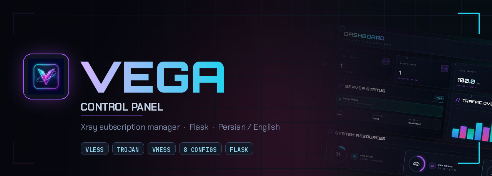
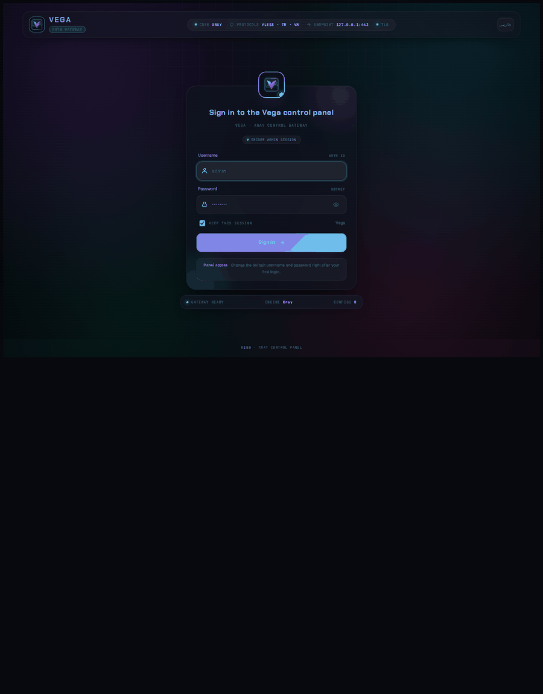
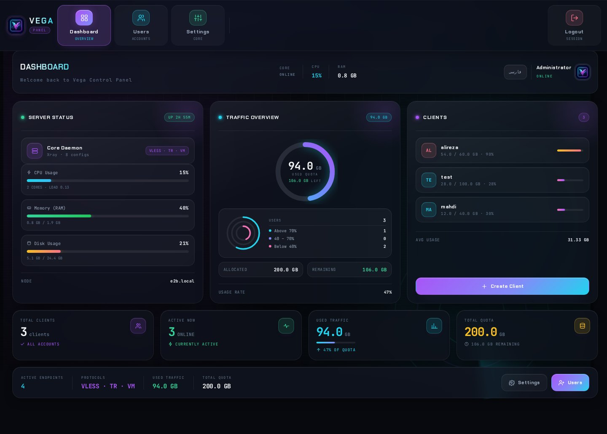
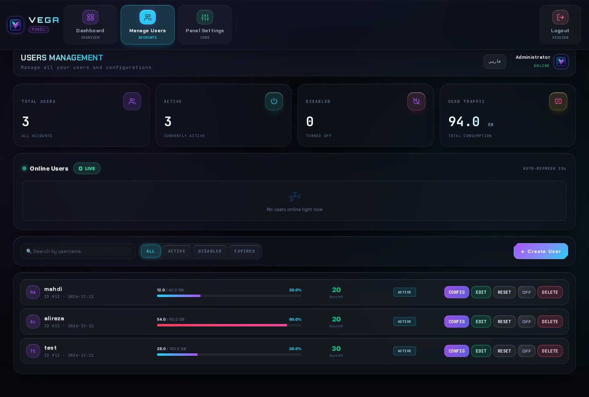
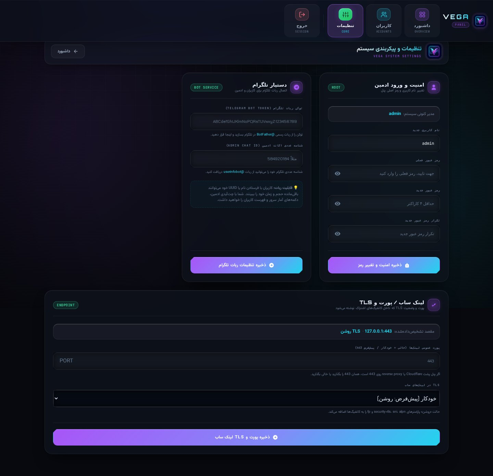
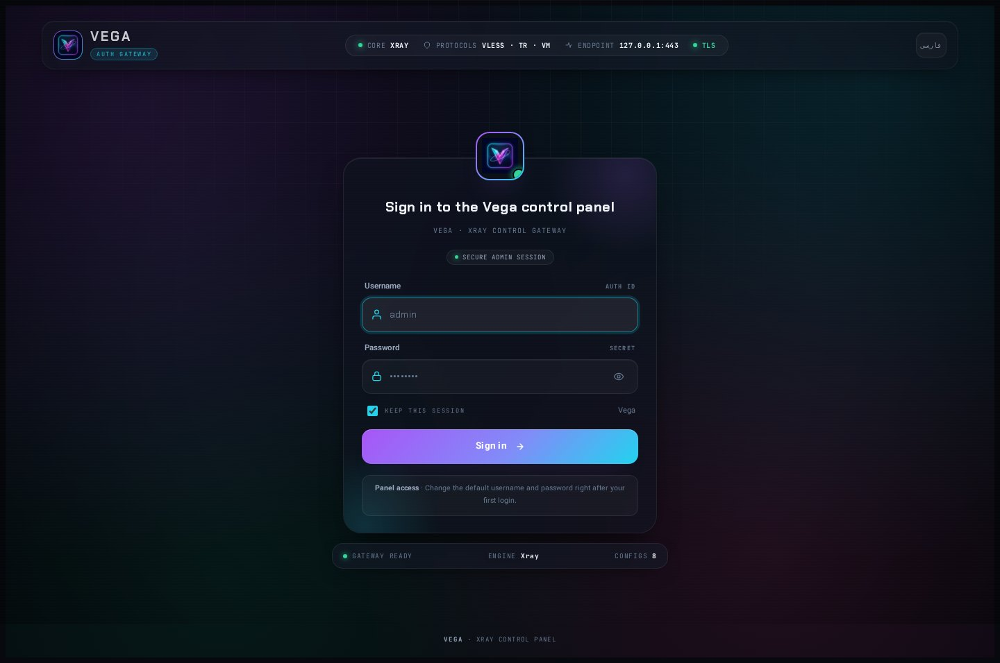
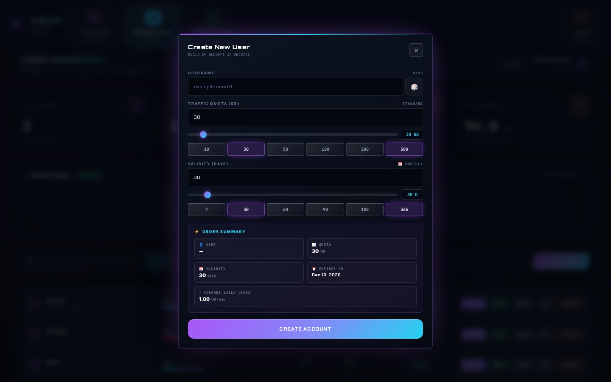
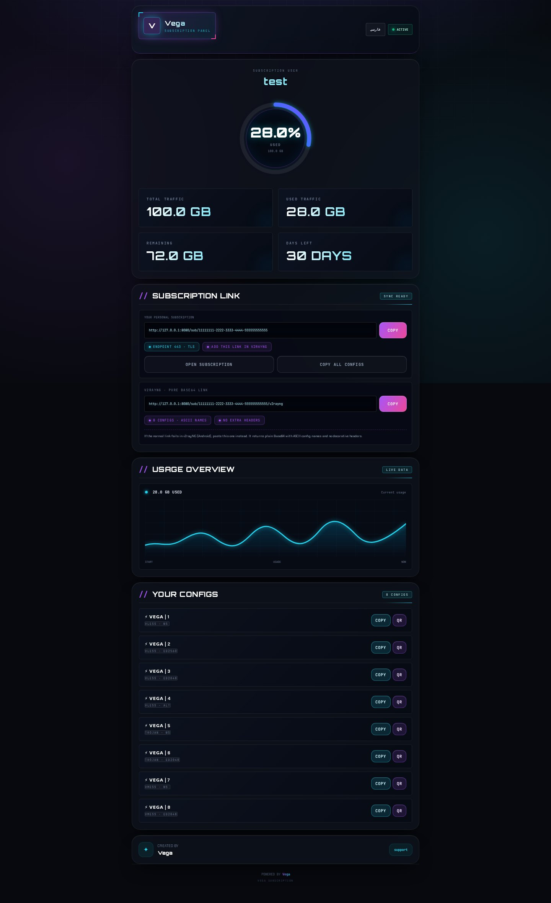
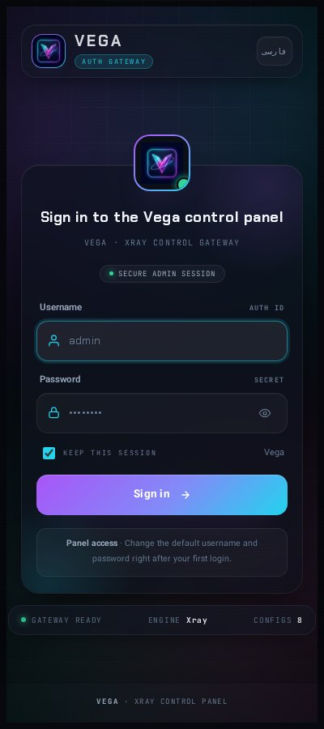

<div align="center">
  
</div>

<h3 align="center">پنل سبک و موبایل‌محور برای اشتراک‌های Xray</h3>

<p align="center">
  یک کاربر، یک UUID، <b>هشت کانفیگ آماده</b> — VLESS، Trojan و VMess،<br />
  با محاسبهٔ مصرف لحظه‌ای، سهمیه و انقضا، و رابط فارسی / انگلیسی.
</p>

<p align="center">
  
  
  
  
  
  
  
</p>

<p align="center">
  <a href="#-امکانات">امکانات</a> ·
  <a href="#-تصاویر">تصاویر</a> ·
  <a href="#-شروع-سریع">شروع سریع</a> ·
  <a href="#-پروتکل‌ها">پروتکل‌ها</a> ·
  <a href="#-تم‌ها">تم‌ها</a> ·
  <a href="README.md">English</a>
</p>

<p align="center">
  
</p>

---

## ✦ چرا Vega

این پروژه یک اپلیکیشن کوچک Flask است با یک فایل SQLite و **بدون هیچ مرحلهٔ build
سمت فرانت‌اند**. رابط کاربری اول روی صفحهٔ ۳۹۰ پیکسلی طراحی شده، بعد برای دسکتاپ
گسترش پیدا کرده.

کل ظاهر در یک فایل CSS اختیاری جمع شده، پس منطق و API هنگام تغییر استایل دست‌نخورده
می‌مانند.

---

## ✦ امکانات

| | |
|---|---|
| **⚡ هشت کانفیگ برای هر کاربر** | ۴ × VLESS، ۲ × Trojan، ۲ × VMess — همه از یک UUID |
| **📊 محاسبهٔ واقعی مصرف** | حجم هر کاربر از API آمار Xray خوانده و با سهمیه اش جمع می‌شود |
| **⏳ سهمیه و انقضا** | محدودیت گیگابایتی و اعتبار روزانه، با مدیریت خودکار حساب‌های منقضی |
| **👥 مدیریت کاربران** | ساخت، ویرایش، فعال/غیرفعال، ریست مصرف و حذف — از پنل یا API |
| **🔗 لینک اشتراک** | صفحهٔ اختصاصی هر کاربر با دکمهٔ کپی، کد QR و حلقهٔ مصرف |
| **🖥️ منابع سیستم** | مصرف CPU، رم و دیسک مستقیماً از `/proc` (بدون `psutil`) |
| **🤖 ربات تلگرام (اختیاری)** | استعلام وضعیت برای کاربر و گزارش کلی برای مدیر |
| **🌐 دو زبانه** | فارسی (RTL) و انگلیسی (LTR)، سمت کلاینت و ماندگار |
| **🎨 رابط شیشه‌ای تک‌تم** | یک اسکین، درست اجرا شده: داک شیشه‌ای، نوار بالا و ویجت‌های شناور — بدون حالت روشن نصفه‌نیمه |
| **🐳 دیپلوی یک‌دستوری** | ایمیج Docker هم nginx و هم هستهٔ Xray را آماده دارد |

---

## ✦ تصاویر

> همه از اسکین داخلی **Obsidian HUD** گرفته شده‌اند.

<div align="center">

<p><b>داشبورد</b> — آمار ترافیک، وضعیت سرور و گیج‌های زندهٔ CPU / رم / دیسک</p>



<br />

<table>
<tr>
<td width="33%" valign="top"><b>کاربران</b><br /></td>
<td width="33%" valign="top"><b>تنظیمات</b><br /></td>
<td width="33%" valign="top"><b>ورود</b><br /></td>
</tr>
</table>

<br />

<p><b>ساخت کاربر</b> — مودال شیشه‌ای با پریست‌های حجم/اعتبار و خلاصهٔ زندهٔ سفارش</p>



<br />

<p><b>صفحهٔ اشتراک</b> — حلقهٔ مصرف، سهمیه، انقضا، لینک اشتراک و هر ۸ کانفیگ</p>



<br />

<p><b>موبایل</b> — طرح اولیه برای همین صفحه بود</p>



</div>

---

## ✦ شروع سریع

### Docker (پیشنهادی)

```bash
git clone https://github.com/<you>/vega-panel.git
cd vega-panel

docker build -t vega .

docker run -d --name vega \
  -p 8080:8080 \
  -e SECRET_KEY="$(openssl rand -hex 32)" \
  -e ADMIN_USER="admin" \
  -e ADMIN_PASS="change-me-now" \
  -v "$PWD/data:/app/data" \
  vega
```

سپس `http://<server-ip>:8080` را باز کنید.

### نصب دستی

نیازمندی‌ها: **Python 3.10+**، **nginx** و باینری **Xray-core** روی سرور.

```bash
python3 -m venv .venv && source .venv/bin/activate
pip install -r requirements.txt

export SECRET_KEY="$(openssl rand -hex 32)"
export ADMIN_USER="admin"
export ADMIN_PASS="change-me-now"

sudo python3 app.py     # Xray را بالا می‌آورد، nginx.conf را می‌نویسد و پنل را سرو می‌کند
```

`app.py` خودِ Flask را روی `127.0.0.1:5000` می‌نشاند و پورت عمومی دست **nginx**
است؛ همین باعث می‌شود `/ws`، `/tr`، `/vm` و خود پنل یک endpoint مشترک داشته باشند.

---

## ✦ پروتکل‌ها

برای هر کاربر هشت کانفیگ ساخته می‌شود. سمت سرور سه inbound جدا وجود دارد و nginx
بر اساس پیشوند مسیر مسیردهی می‌کند:

```
                        ┌── /ws/*  ──→  127.0.0.1:10000   VLESS  (WebSocket)
nginx  :8080 / :443  ───┼── /tr/*  ──→  127.0.0.1:10001   Trojan (WebSocket)
                        ├── /vm/*  ──→  127.0.0.1:10002   VMess  (WebSocket)
                        └── /*     ──→  127.0.0.1:5000    پنل Flask
```

| # | پروتکل | ترنسپورت | مسیر | توضیح |
|:-:|---|---|---|---|
| ۱ | VLESS | WS | `/ws/{uuid}` | استاندارد |
| ۲ | VLESS | WS + `ed=2560` | `/ws/{uuid}` | early data |
| ۳ | VLESS | WS + `ed=2048` | `/ws/{uuid}` | early data |
| ۴ | VLESS | WS | `/ws/{uuid}` | پارامترهای تصادفی |
| ۵ | Trojan | WS | `/tr/{uuid}` | رمز = UUID |
| ۶ | Trojan | WS + `ed=2048` | `/tr/{uuid}` | early data |
| ۷ | VMess | WS | `/vm/{uuid}` | شناسه = UUID |
| ۸ | VMess | WS + `ed=2048` | `/vm/{uuid}` | early data |

نام کانفیگ‌ها عمداً کوتاه است:

```
⚡ 𝗩𝗘𝗚𝗔 | 1 | username
```

هر سه پروتکل یک UUID مشترک دارند، بنابراین مصرف همهٔ کانفیگ‌ها روی یک حساب جمع
می‌شود و محاسبهٔ سهمیه ساده می‌ماند.

---

## ✦ لینک اشتراک (برای کلاینت‌ها)

`/sub/<uuid>` **یک آدرس است که برای هر دو مخاطب درست رفتار می‌کند**:

| چه کسی درخواست می‌دهد | چه چیزی می‌گیرد |
|---|---|
| v2rayNG، Clash، Hiddify، sing-box، NekoBox، okhttp، `curl` … | `text/plain` شامل base64 هر ۸ کانفیگ + هدر `Subscription-Userinfo` |
| مرورگر (UA از نوع Mozilla/Chrome/Safari) | صفحهٔ HTML اشتراک |
| هر چیز دیگر / صریح | `?raw=1` یا `/sub/<uuid>/raw` → همیشه base64 · `?view=1` → همیشه HTML |

### لینک اختصاصی v2rayNG (Base64 خالص)

اگر لینک اصلی در **v2rayNG اندروید** رد شد، از لینک دومی که پایین صفحهٔ اشتراک
نمایش داده می‌شود استفاده کنید:

```
https://your-domain/sub/<uuid>/v2rayng        (= https://your-domain/sub64/<uuid>)
```

تفاوت‌ها — هر دلیلی که یک پارسر سخت‌گیر بتواند گیر کند حذف شده است:

| | لینک اصلی | لینک `/v2rayng` |
|---|---|---|
| بدنه | base64 (یا HTML برای مرورگر) | **همیشه** base64، یک‌خطی، الفبای استاندارد، بدون خط انتهایی و بدون BOM |
| نام کانفیگ | `⚡ 𝗩𝗘𝗚𝗔 \| 1 \| user` | `VEGA \| 1 \| user` (فقط ASCII) |
| هدر `Profile-Title` | دارد | **ندارد** — فقط `Subscription-Userinfo` و `Profile-Update-Interval` |
| تشخیص User-Agent | دارد | ندارد — برای همهٔ کلاینت‌ها یکسان |

اضافه‌ها: `?full=1` نام‌های ایموجی‌دار را برمی‌گرداند و `?plain=1` همان ۸ خط را بدون
base64 می‌دهد (برای دیباگ در مرورگر).

### هاست / پورت / TLS در کانفیگ‌ها

قبلاً پورت کانفیگ‌ها روی `:443` با TLS ثابت بود و هر وقت پنل روی پورت دیگری یا
روی HTTP ساده بالا می‌آمد، کلاینت با شکست مواجه می‌شد. حالا مقصد از خود درخواست
تشخیص داده می‌شود:

1. `SUB_PORT` (متغیر محیطی) یا تنظیمات `sub_port` — از مسیر
   **تنظیمات ← لینک ساب / پورت و TLS**
2. وگرنه هدرهای `X-Forwarded-Proto` / `X-Forwarded-Host` از reverse proxy
3. **وگرنه پورت `443` با TLS روشن** — پیش‌فرض درست، حتی اگر خودِ پنل روی
   `http://…:8080` باز شود

TLS به‌صورت پیش‌فرض روشن است و پورت‌های `443, 8443, 2053, 2083, 2087, 2096`
TLS در نظر گرفته می‌شوند. با `SUB_TLS=1` / `SUB_TLS=0` یا همان انتخابگر
صفحهٔ تنظیمات می‌شود دستی عوضش کرد. در حالت TLS همهٔ لینک‌ها `security=tls`،
`sni`، `alpn` و `fp` دارند و در حالت بدون TLS این پارامترها حذف می‌شوند.

روی صفحهٔ اشتراک یک چیپ کوچک مقصد تشخیص‌داده‌شده را نشان می‌دهد
(`پورت 8080 · بدون TLS`) تا بدانی کلاینت به چه چیزی وصل می‌شود.

---

## ✦ پوستهٔ شیشه‌ای (داک)

بخش مدیریت یک پوستهٔ شیشه‌ای مشترک دارد که همهٔ صفحه‌ها از آن استفاده می‌کنند:

* یک **داک شناور** بالای صفحه فقط با چهار مقصد واقعی
  (`داشبورد`، `کاربران`، `تنظیمات`، `خروج`) — آیکون‌ها کاشی‌های شیشه‌ای
  رنگ‌بندی‌شده بر اساس بخش هستند و آیتم فعال درخشان می‌شود؛
* یک **نوار بالا** شیشه‌ای با ریبون زندهٔ `هسته / CPU / RAM`، دکمهٔ زبان
  و نشان ادمین؛
* **ویجت‌های شیشه‌ای** در داشبورد: وضعیت سرور (CPU/RAM/دیسک زنده)، نمای
  ترافیک با گیج دایره‌ای و رینگ‌های قطبی فشار سهمیه، و فهرست کوتاه
  کاربران — همه با دادهٔ واقعی؛
* چهار **کارت آماری** و یک ریبون پایین با جمع‌ها و میان‌برها.

همهٔ این‌ها از `static/glass.css` می‌آیند و هر رنگ یک توکن `--g-*` است؛
پس عوض کردن کل رنگ‌بندی پنل یعنی ویرایش شش متغیر — بدون قاعدهٔ تکراری و
بدون دست‌کاری چیدمان با جاوااسکریپت.

ریبون نوار بالا و نوارهای ویجت‌ها هر ۳ ثانیه `/api/system` را صدا می‌زنند،
پس CPU / RAM / دیسک و آپتایم زنده‌اند و مقدار نمایشی نیستند.

## ✦ تم

استایل از چند فایل override تشکیل شده که **بعد** از استایل قالب‌ها لود می‌شوند. هیچ
کلاس، شناسه یا تابعی عوض نمی‌شود — فقط `href` یک `<link>`.

| فایل | کاربرد |
|---|---|
| `static/glass.css` | **پوستهٔ شیشه‌ای** — داک، نوار بالا، کارت‌ها و ویجت‌ها؛ همهٔ رنگ‌ها توکن `--g-*` |
| `static/theme-hud.css` | لایهٔ پایهٔ **Obsidian HUD** (براکت گوشه‌ها، گرید ماتریکسی، رادار) |
| `static/theme.css` | **POP** — یک ظاهر روشن جایگزین، فقط به‌عنوان فایل مرجع مانده |

پنل **فقط تیره** است. تم روشن، دکمهٔ ☀/☾ و `theme-toggle.js` عمداً حذف شدند:
یک تم، یک ظاهر، بدون صفحه‌های نصفه‌کاره.

رنگ‌ها توکن‌های بالای `glass.css` هستند؛ با همین شش متغیر کل پنل عوض می‌شود:

```css
:root{
    --g-bg:     #07090e;   /* پس‌زمینه */
    --g-violet: #a855f7;   /* اکسنت اصلی */
    --g-indigo: #818cf8;
    --g-cyan:   #22d3ee;   /* اکسنت دوم */
    --g-emerald:#34d399;
    --g-pink:   #f472b6;
}
```

---

## ✦ تنظیمات

| متغیر | پیش‌فرض | کاربرد |
|---|---|---|
| `SECRET_KEY` | مقدار توسعه | کلید امضای نشست — **عوض کنید** |
| `ADMIN_USER` | `admin` | نام کاربری پنل |
| `ADMIN_PASS` | `admin` | رمز عبور پنل — **عوض کنید** |
| `PORT` | `8080` | پورت عمومی nginx |
| `XRAY_LOCATION_ASSET` | — | مسیر فایل‌های asset هستهٔ Xray |
| `SUB_PORT` | خودکار | پورت عمومی که در لینک کانفیگ‌ها نوشته می‌شود |
| `SUB_TLS` | خودکار | اجبار TLS روشن (`1`) یا خاموش (`0`) در لینک‌ها |

اگر `ADMIN_USER` و `ADMIN_PASS` تعریف نشوند، اطلاعات ورود از `panel_settings.json`
خوانده می‌شود (از صفحهٔ تنظیمات قابل تغییر است).

### مسیرهای API

| مسیر | متد | خروجی |
|---|---|---|
| `/api/system` | GET | درصد CPU، رم، دیسک، آپتایم و load average |
| `/api/online_users` | GET | کاربران آنلاین |
| `/api/add_user` · `/api/edit_user/<id>` · `/api/delete_user/<id>` | POST | عملیات CRUD |
| `/api/toggle_user/<id>` · `/api/reset_user/<id>` | POST | فعال/غیرفعال، ریست مصرف |
| `/api/user_config/<id>` | GET | کانفیگ‌های یک کاربر |
| `/sub/<uuid>` | GET | **لینک ساب base64 برای کلاینت‌ها**، صفحهٔ HTML برای مرورگر |
| `/sub/<uuid>/raw` | GET | همیشه base64 (مثل `?raw=1`) |
| `/sub/<uuid>/v2rayng` · `/sub64/<uuid>` | GET | **base64 سازگار با v2rayNG** — نام ASCII، هدر مینیمال |
| `/sub/<uuid>?view=1` | GET | اجبار به نمایش صفحهٔ HTML |

---

## ✦ ساختار

```
.
├── app.py                 # اپلیکیشن Flask، سازندهٔ کانفیگ‌ها، راه‌انداز Xray و nginx
├── templates/
│   ├── login.html
│   ├── dashboard.html
│   ├── users.html
│   ├── settings.html
│   └── subscription.html
├── static/
│   ├── logo.png
│   ├── theme-hud.css      # اسکین Obsidian HUD
│   └── theme.css          # اسکین POP
├── docs/                  # بنر، گیف پیش‌نمایش و اسکرین‌شات‌ها
├── requirements.txt
├── Dockerfile
└── README.md
```

فایل‌های وضعیت (دیتابیس SQLite، کانفیگ Xray و `nginx.conf`) کنار پوشهٔ اجرا ساخته
می‌شوند؛ اگر می‌خواهید بعد از ری‌استارت باقی بمانند، mount کنید.

---

## ✦ نکات امنیتی

پیش از عمومی‌کردن پنل:

- [ ] `SECRET_KEY` واقعی و رمز مدیر قوی بگذارید
- [ ] پنل را پشت TLS ببرید (کانفیگ nginx همراه پروژه نقطهٔ شروع است)
- [ ] اگر ممکن است دسترسی پنل را به IP خودتان محدود کنید
- [ ] لینک‌های `/sub/<uuid>` را خصوصی نگه دارید — داشتن UUID یعنی دسترسی
- [ ] از `users.db` بکاپ بگیرید

---

<div align="center">

<p align="center">
  <b>ساخته‌شده برای کسانی که پنل سریع و خوش‌ظاهر می‌خواهند.</b><br />
  اگر Vega به کارتان آمد، یک ⭐ بیشتر از آنچه فکر می‌کنید کمک می‌کند.
</p>

<p align="center"><a href="README.md">🇬🇧 English</a></p>

</div>
