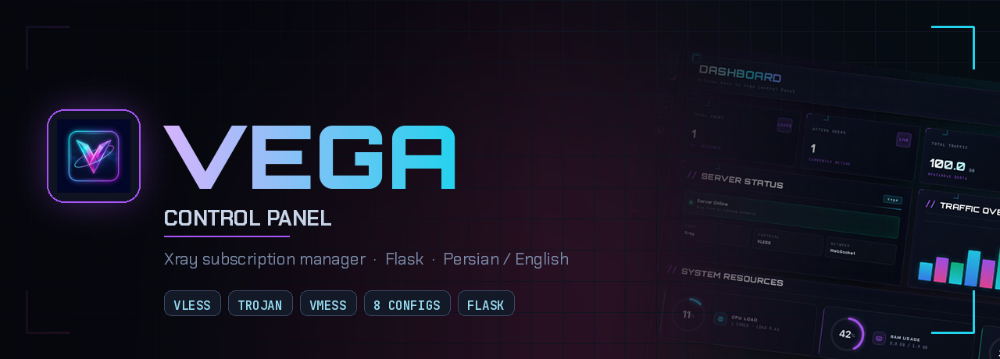
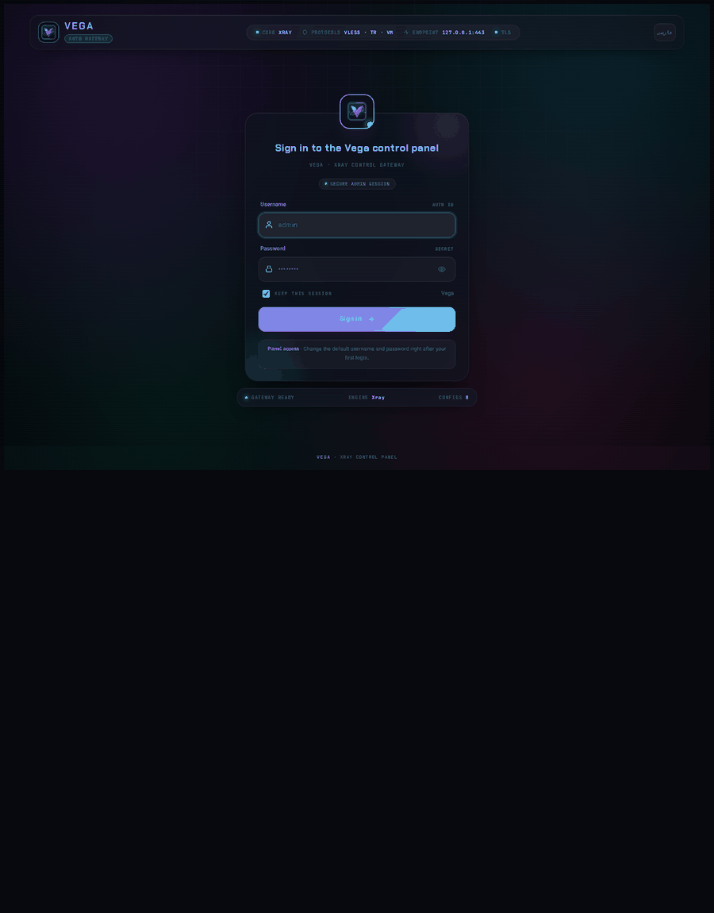
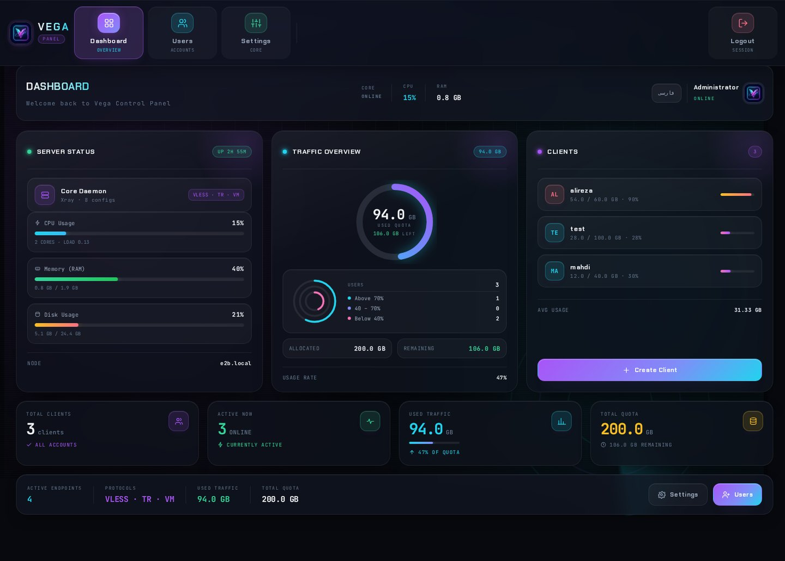
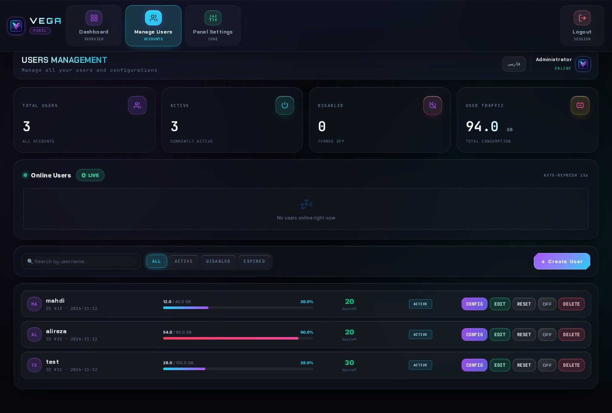
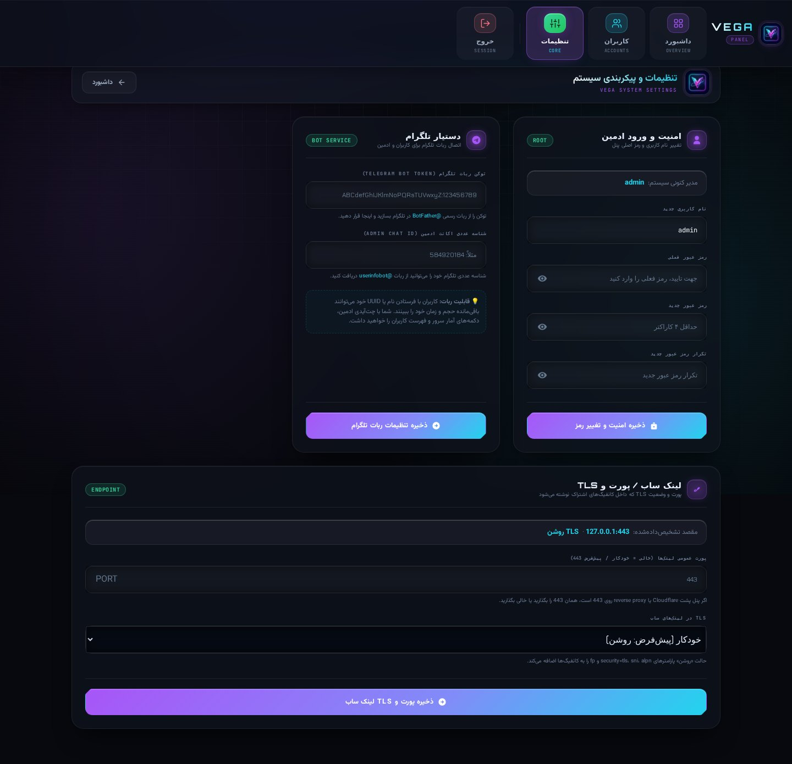
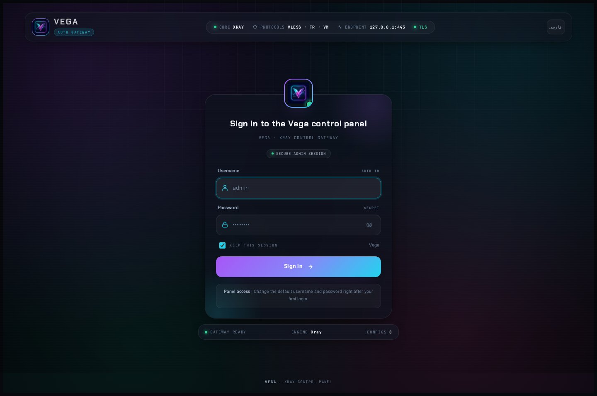
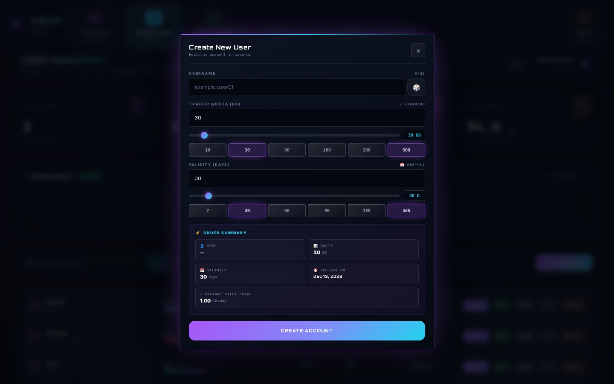
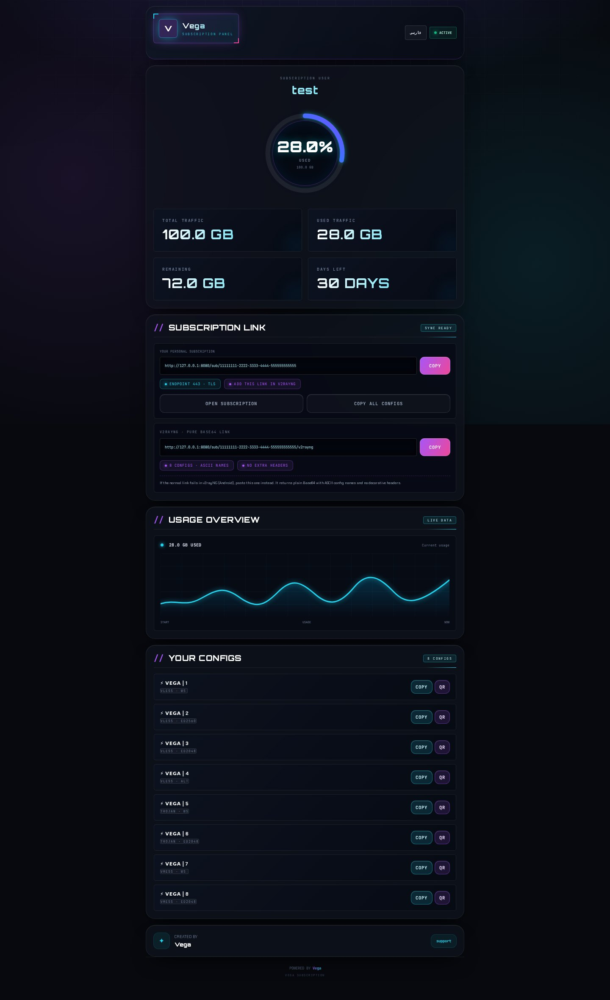
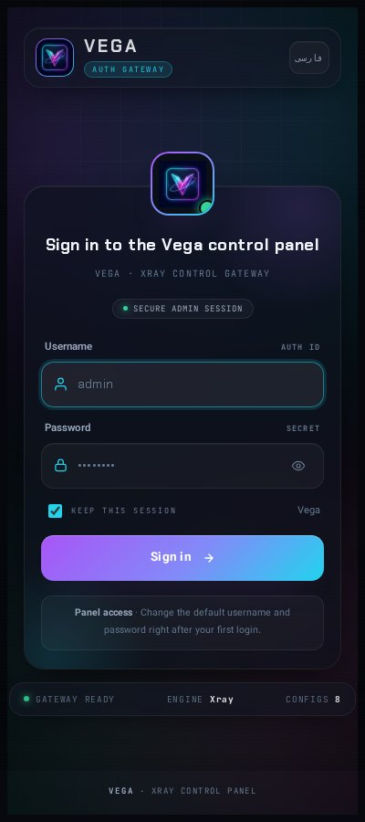

<div align="center">
  
</div>

<h3 align="center">A lean, mobile-first panel for Xray subscriptions</h3>

<p align="center">
  One user, one UUID, <b>eight ready-to-use configs</b> — VLESS, Trojan and VMess, with live<br />
  traffic accounting, expiring quotas and a Persian / English interface.
</p>

<p align="center">
  
  
  
  
  
  
  
</p>

<p align="center">
  <a href="#-features">Features</a> ·
  <a href="#-screenshots">Screenshots</a> ·
  <a href="#-quick-start">Quick start</a> ·
  <a href="#-protocols--configs">Protocols</a> ·
  <a href="#-themes">Themes</a> ·
  <a href="README.fa.md">فارسی</a>
</p>

<p align="center">
  
</p>

---

## ✦ Why Vega

Most subscription panels are heavy, theme-locked and painful on a phone. Vega is the
opposite: **a single small Flask app, a self-contained SQLite file, zero front-end
build step** and a UI that was designed on a 390 px screen first.

The whole look lives in one optional CSS file, so the logic and the API never change
when you restyle it.

---

## ✦ Features

| | |
|---|---|
| **⚡ 8 configs per user** | 4 × VLESS, 2 × Trojan, 2 × VMess — generated from the same UUID |
| **📊 Real traffic accounting** | Per-user bytes pulled from the Xray gRPC stats API and reconciled into quotas |
| **⏳ Quota + expiry** | GB limits and day-based expiry, with expired / limited accounts handled automatically |
| **👥 User management** | Create, edit, enable / disable, reset usage, delete — from the panel or the API |
| **🔗 Subscription links** | A clean per-user page with copy buttons, QR code and usage ring |
| **🖥️ Live system resources** | CPU, RAM and disk read straight from `/proc`, no `psutil` required |
| **🤖 Optional Telegram bot** | Users can query their own status; admins get a summary |
| **🌐 Bilingual UI** | Full Persian (RTL) and English (LTR), switched client-side and remembered |
| **🎨 Dark-only glass UI** | One skin, done properly: glassmorphic dock, app bar, floating widgets — no half-finished light mode |
| **🐳 One-command deploy** | Docker image ships nginx **and** the Xray core already wired together |

---

## ✦ Screenshots

> Taken from the built-in **Obsidian HUD** skin.

<div align="center">

<p><b>Dashboard</b> — traffic stats, server status and live CPU / RAM / disk gauges</p>



<br />

<table>
<tr>
<td width="33%" valign="top"><b>Users</b><br /></td>
<td width="33%" valign="top"><b>Settings</b><br /></td>
<td width="33%" valign="top"><b>Login</b><br /></td>
</tr>
</table>

<br />

<p><b>Create client</b> — glass modal with quota / validity presets and a live order summary</p>



<br />

<p><b>Subscription page</b> — usage ring, quota, expiry, subscription link and all 8 configs</p>



<br />

<p><b>Mobile</b> — the layout it was designed for</p>



</div>

---

## ✦ Quick start

### Docker (recommended)

```bash
git clone https://github.com/<you>/vega-panel.git
cd vega-panel

docker build -t vega .

docker run -d --name vega \
  -p 8080:8080 \
  -e SECRET_KEY="$(openssl rand -hex 32)" \
  -e ADMIN_USER="admin" \
  -e ADMIN_PASS="change-me-now" \
  -v "$PWD/data:/app/data" \
  vega
```

Open `http://<server-ip>:8080`.

### Manual

Requires **Python 3.10+**, **nginx** and the **Xray-core** binary on the host.

```bash
python3 -m venv .venv && source .venv/bin/activate
pip install -r requirements.txt

export SECRET_KEY="$(openssl rand -hex 32)"
export ADMIN_USER="admin"
export ADMIN_PASS="change-me-now"

sudo python3 app.py     # starts Xray, writes nginx.conf, then serves the panel
```

`app.py` binds Flask to `127.0.0.1:5000` and lets **nginx** own the public port — that is
what makes `/ws`, `/tr` and `/vm` share one TLS endpoint with the panel.

---

## ✦ Protocols & configs

Each user gets eight configs. Server-side there are **three separate inbounds**, and
nginx routes by path prefix:

```
                        ┌── /ws/*  ──→  127.0.0.1:10000   VLESS  (WebSocket)
nginx  :8080 / :443  ───┼── /tr/*  ──→  127.0.0.1:10001   Trojan (WebSocket)
                        ├── /vm/*  ──→  127.0.0.1:10002   VMess  (WebSocket)
                        └── /*     ──→  127.0.0.1:5000    Flask panel
```

| # | Protocol | Transport | Path | Notes |
|:-:|---|---|---|---|
| 1 | VLESS | WS | `/ws/{uuid}` | standard |
| 2 | VLESS | WS + `ed=2560` | `/ws/{uuid}` | early data |
| 3 | VLESS | WS + `ed=2048` | `/ws/{uuid}` | early data |
| 4 | VLESS | WS | `/ws/{uuid}` | randomized params |
| 5 | Trojan | WS | `/tr/{uuid}` | password = UUID |
| 6 | Trojan | WS + `ed=2048` | `/tr/{uuid}` | early data |
| 7 | VMess | WS | `/vm/{uuid}` | id = UUID |
| 8 | VMess | WS + `ed=2048` | `/vm/{uuid}` | early data |

Config remarks are kept deliberately short:

```
⚡ 𝗩𝗘𝗚𝗔 | 1 | username
```

All three protocols share one UUID, so usage from every config lands on the same
account and the quota maths stays trivial.

---

## ✦ Subscription links (clients)

`/sub/<uuid>` is **one URL that behaves correctly for both audiences**:

| Who asks | What they get |
|---|---|
| v2rayNG, Clash, Hiddify, sing-box, NekoBox, okhttp, `curl` … | `text/plain` base64 of all 8 configs + `Subscription-Userinfo` |
| a browser (Mozilla/Chrome/Safari UA) | the styled HTML subscription page |
| anything else / explicit | `?raw=1` or `/sub/<uuid>/raw` → always base64 · `?view=1` → always HTML |

Response headers sent with the raw payload:

```
Subscription-Userinfo: upload=0; download=…; total=…; expire=…
Profile-Title: base64:4pqhIFZlZ2E=
Profile-Update-Interval: 12
```

### Dedicated v2rayNG link (pure base64)

If the main link is rejected by **v2rayNG on Android**, use the second link that every
subscription page shows:

```
https://your-domain/sub/<uuid>/v2rayng        (= https://your-domain/sub64/<uuid>)
```

What is different about it — built to remove every reason a strict parser can fail:

| | main link | `/v2rayng` link |
|---|---|---|
| body | base64 (or HTML for browsers) | **always** base64, one line, standard alphabet, no trailing newline, no BOM |
| config names | `⚡ 𝗩𝗘𝗚𝗔 \| 1 \| user` | `VEGA \| 1 \| user` (ASCII only) |
| `Profile-Title` header | yes | **no** — only `Subscription-Userinfo` + `Profile-Update-Interval` |
| User-Agent sniffing | yes | none — the same body for every client |

Extras: `?full=1` keeps the emoji/unicode names, `?plain=1` returns the 8 raw lines
without base64 (paste it in a browser to debug what the app receives).

### The host / port / TLS in generated configs

Configs used to be hard-coded to `:443` + TLS, which broke clients whenever the panel
was actually reachable on another port or over plain HTTP. The endpoint is now derived
from the request itself:

1. `SUB_PORT` (env) or the `sub_port` setting — set it in
   **Settings → Subscription link / port & TLS**
2. otherwise `X-Forwarded-Proto` / `X-Forwarded-Host` from your reverse proxy
3. **otherwise `443` with TLS on** — the sane default, even if the panel itself is
   reachable on `http://…:8080` behind a proxy

TLS is on by default; ports `443, 8443, 2053, 2083, 2087, 2096` are treated as TLS.
Override explicitly with `SUB_TLS=1` / `SUB_TLS=0` (env) or the select box in
Settings. In TLS mode every link carries `security=tls`, `sni`, `alpn` and `fp`; in
non‑TLS mode those parameters are stripped so clients don't choke.

The subscription page shows a small chip with the detected endpoint
(`ENDPOINT 8080 · NO TLS`) so you can see at a glance what the client will connect to.

---

## ✦ Glass shell (dock UI)

The admin area uses a single glass shell that is shared by every page:

* a **floating dock** at the top with the four real destinations only
  (`Dashboard`, `Users`, `Settings`, `Logout`) — every icon is a glass tile,
  colour-coded per section, with an active state that lights up;
* a glass **app bar** with the live core ribbon (`CORE / CPU / RAM`),
  theme switch, language switch and the admin badge;
* **glass widgets** on the dashboard: server status (live CPU / RAM / disk),
  traffic overview with a radial gauge + polar quota-pressure rings, and a
  clients snapshot — all fed by real numbers, nothing mocked;
* four **metric cards** and a bottom ribbon with totals and shortcuts.

Everything is driven by `static/glass.css`, and every colour comes from a
`--g-*` token, so re-skinning the panel means editing six variables — no
duplicated rules, no JS layout work.

The **app bar ribbon and the widget bars poll `/api/system` every 3 s**, so
CPU / RAM / disk and uptime are live, not placeholders.

## ✦ Theming

Styling is a set of override files loaded **after** the template styles. No class, id or
function changes when you restyle — you only touch `<link>` tags.

| File | Purpose |
|---|---|
| `static/glass.css` | **Glass shell** — dock, app bar, cards, widgets. All colours are `--g-*` tokens |
| `static/theme-hud.css` | **Obsidian HUD** base layer (corner brackets, matrix grid, radar sweep) |
| `static/theme.css` | **POP** — an alternative bright look, kept only as a reference file |

The panel ships **dark only**. The light theme, the ☀ / ☾ switch and
`theme-toggle.js` were removed on purpose: one theme, one look, no half-converted pages.

Colours are tokens at the top of `glass.css` — change these six and the whole panel follows:

```css
:root{
    --g-bg:     #07090e;   /* page background */
    --g-violet: #a855f7;   /* primary accent */
    --g-indigo: #818cf8;
    --g-cyan:   #22d3ee;   /* secondary accent */
    --g-emerald:#34d399;
    --g-pink:   #f472b6;
}
```

Fonts (Orbitron, Chakra Petch, JetBrains Mono, Vazirmatn) load from Google Fonts; without
internet the system fonts take over and the layout still holds.

---

## ✦ Configuration

| Variable | Default | Purpose |
|---|---|---|
| `SECRET_KEY` | dev value | Session signing key — **change it** |
| `ADMIN_USER` | `admin` | Panel username |
| `ADMIN_PASS` | `admin` | Panel password — **change it** |
| `PORT` | `8080` | Public port nginx listens on |
| `XRAY_LOCATION_ASSET` | — | Location of the Xray asset directory |
| `SUB_PORT` | auto | Force the public port written into config links |
| `SUB_TLS` | auto | Force TLS on (`1`) or off (`0`) in config links |

If `ADMIN_USER` / `ADMIN_PASS` are unset, credentials come from `panel_settings.json`
(editable from the Settings page).

### API surface

Authenticated (session) routes used by the UI:

| Route | Method | Returns |
|---|---|---|
| `/api/system` | GET | CPU %, RAM, disk, uptime, load average |
| `/api/online_users` | GET | Users seen within the online threshold |
| `/api/add_user` · `/api/edit_user/<id>` · `/api/delete_user/<id>` | POST | CRUD |
| `/api/toggle_user/<id>` · `/api/reset_user/<id>` | POST | Enable / disable, reset usage |
| `/api/user_config/<id>` | GET | Generated configs for one user |
| `/sub/<uuid>` | GET | **Base64 subscription for clients**, HTML page for browsers |
| `/sub/<uuid>/raw` | GET | Always base64 (same as `?raw=1`) |
| `/sub/<uuid>/v2rayng` · `/sub64/<uuid>` | GET | **v2rayNG-safe base64** — ASCII names, minimal headers |
| `/sub/<uuid>?view=1` | GET | Force the HTML page |

---

## ✦ Project structure

```
.
├── app.py                 # Flask app: panel, config builders, Xray + nginx bootstrap
├── templates/
│   ├── login.html
│   ├── dashboard.html
│   ├── users.html
│   ├── settings.html
│   └── subscription.html
├── static/
│   ├── logo.png
│   ├── theme-hud.css      # Obsidian HUD skin
│   └── theme.css          # POP skin
├── docs/                  # README banner, preview gif, screenshots
├── requirements.txt
├── Dockerfile
└── README.fa.md
```

Runtime state (SQLite database, Xray config, `nginx.conf`) is written next to the
working directory — mount it if you want it to survive a container restart.

---

## ✦ Security notes

Before exposing the panel to the internet:

- [ ] Set a real `SECRET_KEY` and a strong admin password
- [ ] Put the panel behind TLS (the bundled nginx config is a starting point)
- [ ] Restrict the panel path to your own IP if you can
- [ ] Keep the `/sub/<uuid>` links private — possession of the UUID is access
- [ ] Back up `users.db` regularly

---

<div align="center">

<p align="center">
  <b>Built for people who want a panel that feels fast and looks good on a phone.</b><br />
  If Vega is useful to you, a ⭐ helps more than you'd think.
</p>

<p align="center"><a href="README.fa.md">🇮🇷 نسخهٔ فارسی</a></p>

</div>
